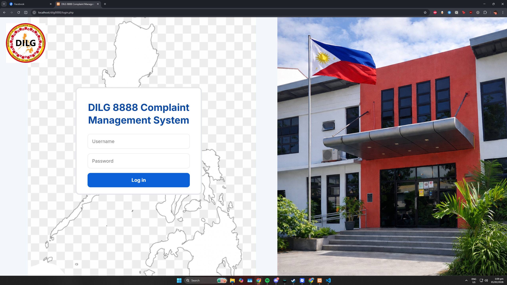
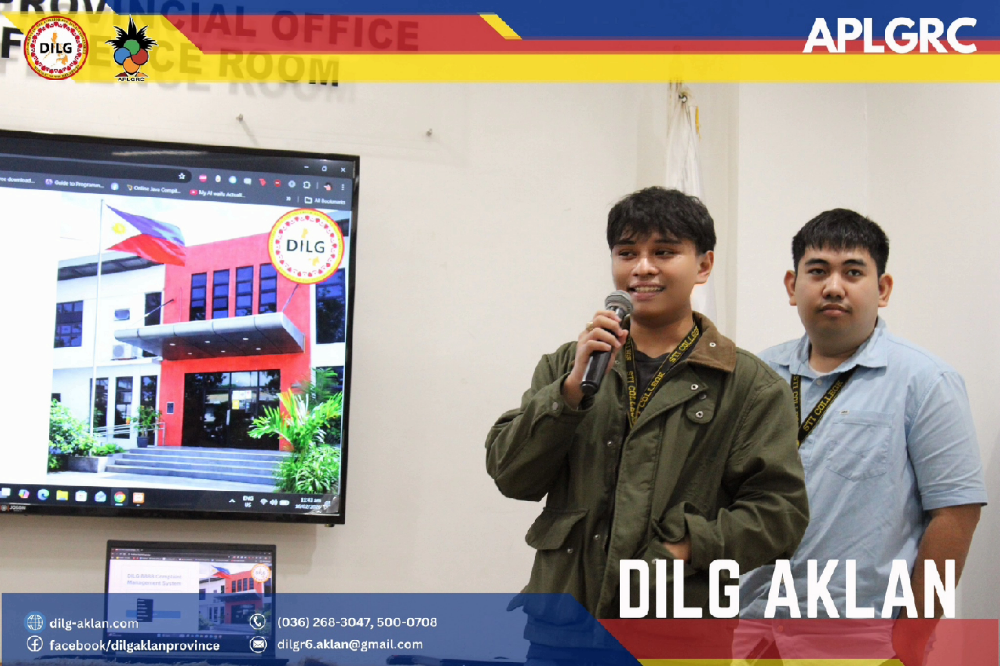
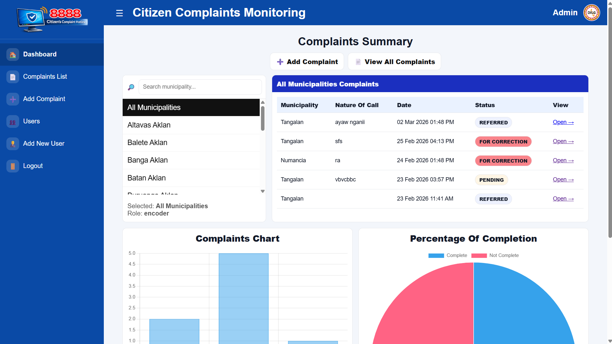
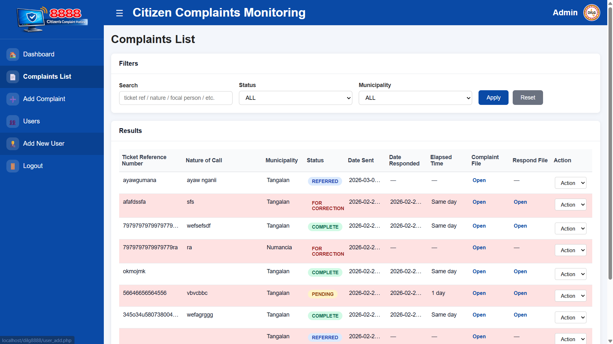
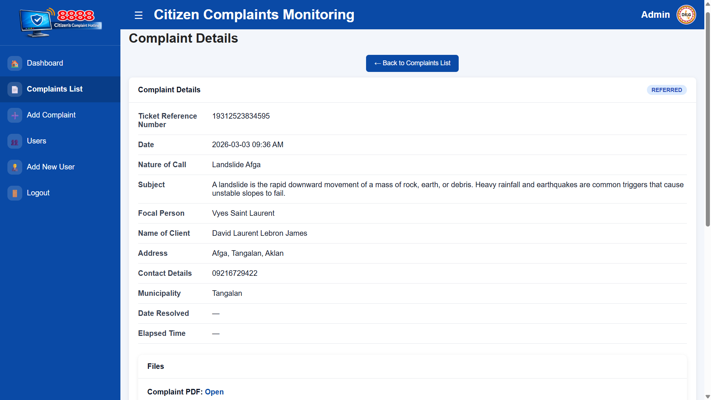

# DILG Aklan 8888 Complaint Management System

Developed during my On-the-Job Training (OJT) at the Department of the Interior and Local Government (DILG) – Aklan.

  

## Overview

The DILG Aklan 8888 Complaint Management System is a web-based application developed to digitize, organize, and monitor the handling of 8888 citizen complaints. The system streamlines the complaint resolution workflow by enabling DILG staff and Local Government Units (LGUs) to securely manage complaint records, upload supporting documents, track progress, and maintain organized archives with role-based access control.

  

## Objectives

- Digitize complaint and resolution record management
- Improve document organization and retrieval
- Track complaint progress through a structured workflow
- Increase transparency and accountability with timestamps and status tracking
- Reduce paperwork and lost records

---

## Technologies Used

- PHP
- MySQL
- HTML
- CSS
- JavaScript

---

## User Roles

### Encoder

- Creates and records new complaints
- Uploads complaint PDF files
- Assigns complaints to municipalities
- Reviews submitted resolutions
- Marks complaints as Complete or Reopens them for revision
- Manages complaint records

### Responder

- Views complaints assigned to their municipality
- Uploads resolution PDF files
- Updates submitted resolutions when permitted
- Responds to encoder requests for revisions

### Viewer

- Read-only access
- Views complaint information
- Downloads complaint and resolution documents

---

## Workflow

1. Encoder records a complaint and uploads the complaint PDF.
2. Complaint is assigned to the responsible municipality.
3. Responder receives the complaint.
4. Responder uploads the resolution PDF.
5. Encoder reviews the submitted resolution.
6. Complaint is either marked Complete or reopened for revision.

---

## Complaint Status

- **Received** – Complaint has been recorded and assigned.
- **Pending** – Resolution submitted or additional action required.
- **Complete** – Resolution approved by the encoder.

---

## Features

- Secure role-based authentication
- Complaint management
- Resolution upload system
- PDF document archiving
- Municipality assignment
- Search and filtering
- Complaint comments
- Dashboard with analytics
- Status tracking
- Timestamp logging
- Notification system

---

## Project Gallery

  

  

  

## Source Code

The application source code is located in the **source-code** folder.

---

## Documentation

Project documentation is available in the **documentation** folder.
